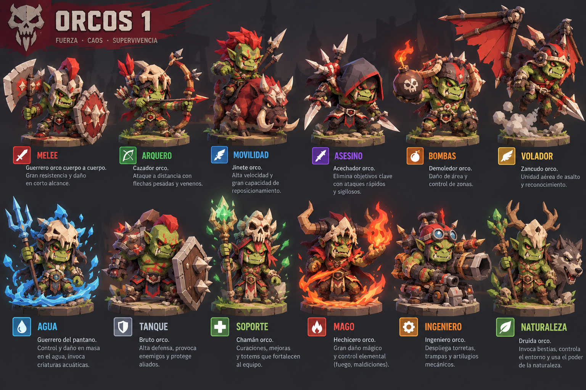
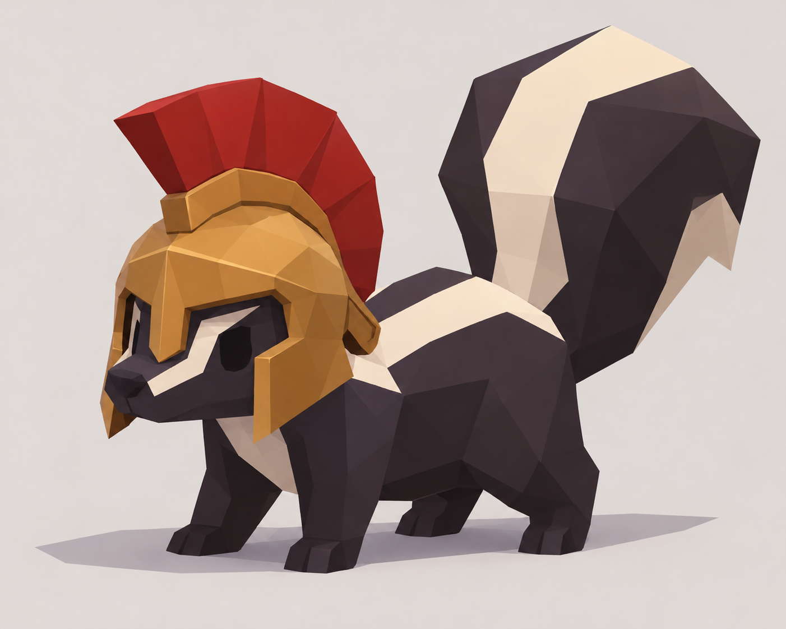

So far this devlog has been code and rules. Today we show **what HexaGonito is going to look like**.

## Twelve roles, two factions

Every faction has the same **twelve roles**: melee, archer, mobility, assassin, bombs, flyer, water, tank, support, mage, engineer and nature. Sharing roles keeps balance readable; each side brings its own personality.

### Humans

Shining armoured soldiers, fire and water mages, a healer, an engineer with a cannon… A low-poly *chibi* style with clean colours.

### Orcs

**Strength, chaos and survival.** Their rider mounts a boar, the shaman raises totems, the druid summons beasts and their flyer is a stilt-walking assault unit.

## Stinky

And this is **Stinky**: a low-poly skunk in a Spartan helmet. His silhouette is the game's logo you see at the top of this page.

The 3D models are already under way in Blender. Coming to the board soon.
