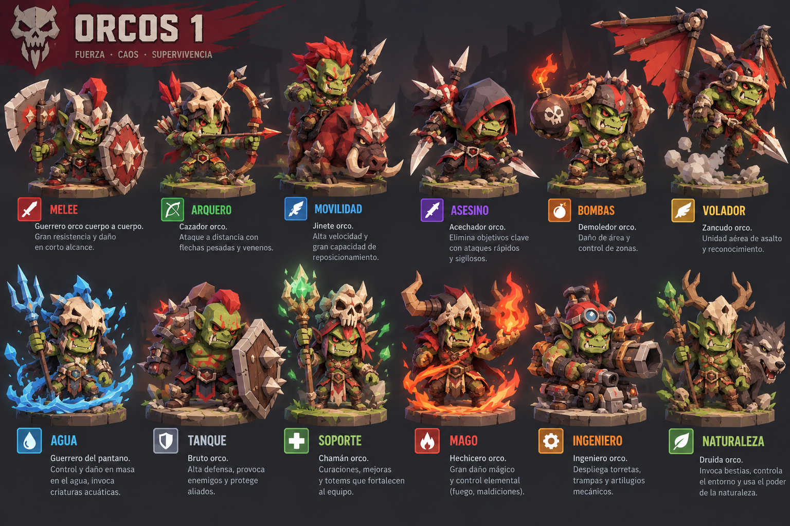
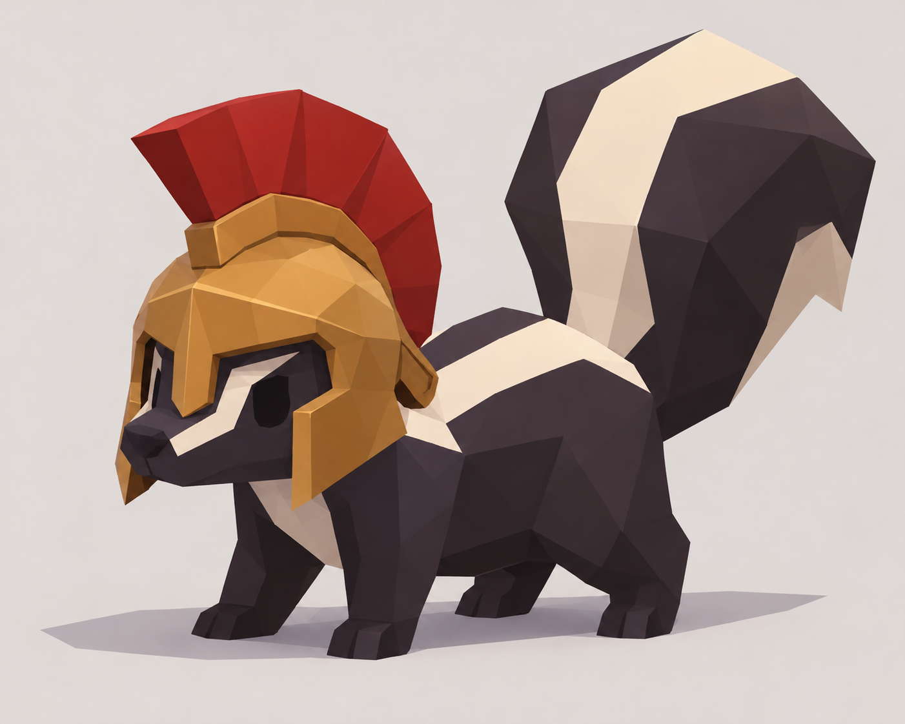

Hasta ahora el devlog ha sido código y reglas. Hoy toca enseñar **cómo se va a ver** HexaGonito.

## Doce roles, dos facciones

Cada facción tiene los mismos **doce roles**: melee, arquero, movilidad, asesino, bombas, volador, agua, tanque, soporte, mago, ingeniero y naturaleza. Compartir roles hace que el balance sea legible; la personalidad la pone cada bando.

### Humanos

Soldados de armadura brillante, magos de fuego y agua, una sanadora, un ingeniero con su cañón… Estilo *chibi* low-poly, con colores limpios.

### Orcos

**Fuerza, caos y supervivencia.** Su jinete monta un jabalí, el chamán levanta tótems, el druida invoca bestias y su volador es un zancudo de asalto.

## Stinky

Y él es **Stinky**: un zorrillo low-poly con casco espartano. Su silueta es el logo del juego que ves arriba en esta página.

Los modelos 3D ya están en marcha en Blender. Pronto, en el tablero.
